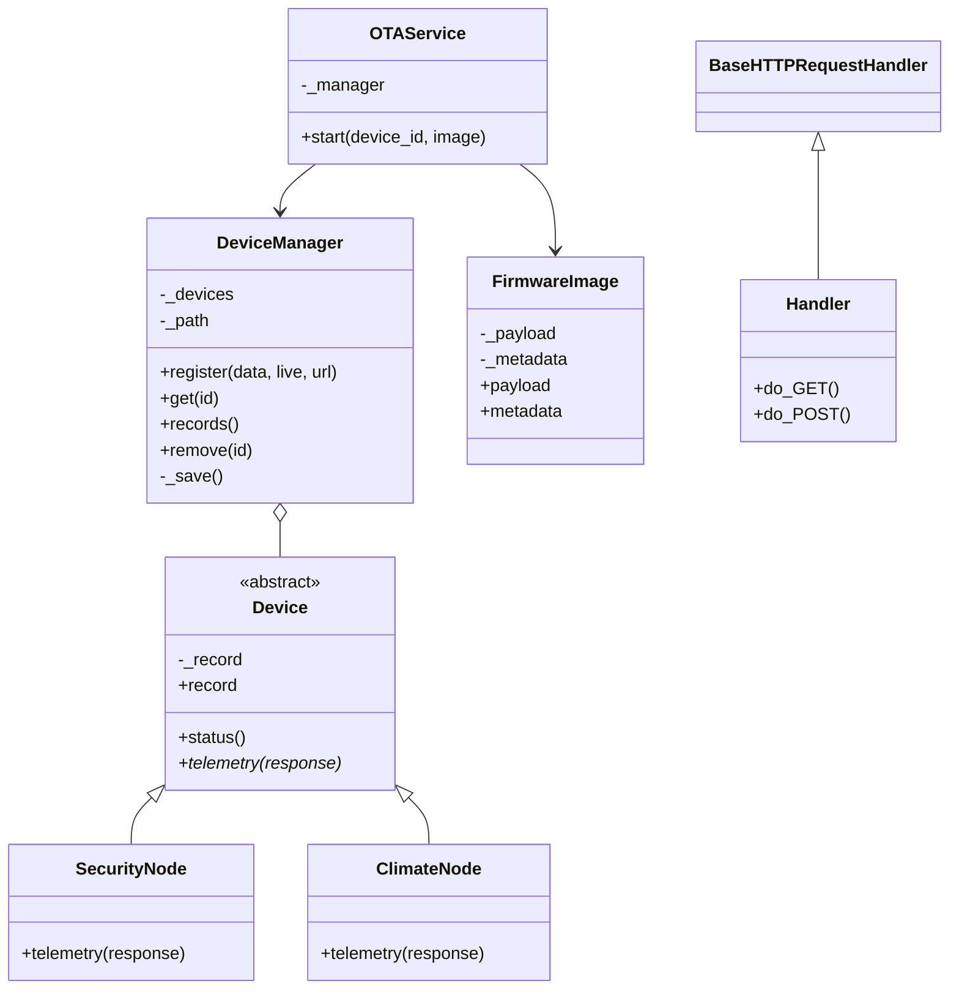

# Python OOP explanation — NEXUS Home Lab

## Project statement

NEXUS is a Python-based local dashboard that manages three embedded devices. An ESP32-S3 provides security/proximity functions, while an ESP32 provides temperature, IR and motor automation. The user selects a device, monitors its state and updates its application over Wi-Fi.

## Class structure

## Concepts you can demonstrate in the actual Python code

| Concept | Exact example | Explanation for viva |
|---|---|---|
| Class | `Device`, `DeviceManager`, `FirmwareImage` | A class defines the data and operations for one responsibility. |
| Object | `manager = DeviceManager(STATE)` | This creates a live instance with its own registered devices and persistence path. |
| Constructor | `FirmwareImage.__init__(payload)` | Initializes immutable firmware bytes and validates the image metadata. |
| Encapsulation | `FirmwareImage._payload`, `Device._record`, `DeviceManager._devices` | Internal state is accessed through properties/methods. `_` is Python's non-public convention, not enforced access protection. |
| Properties | `Device.record`, `FirmwareImage.metadata` | Return copies of mutable dictionaries so callers cannot accidentally change internal state. |
| Abstraction | `class Device(ABC)` and `@abstractmethod telemetry()` | All node types expose the same interface; concrete telemetry details are hidden behind it. An abstract Device cannot be directly instantiated. |
| Inheritance | `SecurityNode(Device)`, `ClimateNode(Device)` | Both reuse identity handling and the common status-fetch method. |
| Method overriding | Each subclass implements `telemetry()` | Security reports distance/LED/buzzer values; climate reports temperature/humidity/IR/motor values. |
| Runtime polymorphism | `Device.status()` calls `self.telemetry(response)` | The actual object's subclass decides which implementation runs. The HTTP handler does not need a separate endpoint implementation for each device kind. |
| Composition / aggregation | `DeviceManager` holds Device objects; `OTAService` holds the manager | Larger functions are built by combining objects with distinct responsibilities. |
| Static method / factory | `DeviceManager._create(record)` | Constructs the correct node subclass from its reported kind. |
| Framework inheritance | `Handler(BaseHTTPRequestHandler)` | Reuses Python's HTTP infrastructure and overrides `do_GET()` / `do_POST()`. |
| Exception handling | Invalid firmware raises `ValueError`; Handler catches it | Errors become useful UI messages instead of silent failures. Exception handling supports robustness but is not itself one of the four core OOP pillars. |

## A short presentation script

“My dashboard uses Python classes to represent physical nodes and their updates. Device is an abstract base class. SecurityNode and ClimateNode inherit from it and override the telemetry method. When I request status, Python chooses the appropriate method at runtime, demonstrating polymorphism. DeviceManager encapsulates the registered devices. FirmwareImage validates and stores the binary. OTAService combines these objects to verify the target, transfer the firmware, and confirm the running build after reboot. The browser is the view; Python performs device management.”

## What happens when Deploy is clicked?

1. Browser sends the application binary and selected device identifier to the Python HTTP handler.
2. The handler constructs a `FirmwareImage`, validating its ESP image/app-description headers and target chip.
3. `OTAService` obtains the selected Device from `DeviceManager`.
4. The live device ID and chip ID are checked immediately before transfer.
5. The background update worker sends multipart HTTP POST to that board's `/update` endpoint over Wi-Fi.
6. ESP32's Update library writes the image to its inactive OTA application partition and finalizes it.
7. The ESP32 restarts into the new firmware.
8. Python compares the board's reported application ELF fingerprint with the uploaded binary's fingerprint before reporting success.

The ELF fingerprint is a build identity, not a digital signature or proof of authenticity. Chip/header checks are not a complete replacement for the device's firmware validation.

## Your working Arduino sketch: be accurate

The earlier `SmartGuard_3Versions.ino` is mainly procedural C++: functions, global state, interrupts and compile-time branches. It uses library objects:

- `WebServer server(80)` is an object constructed from WebServer.
- `server.on()`, `server.handleClient()` and `server.send()` are method calls.
- `WiFi` and `Update` are library-provided objects that hide networking and flash-writing details.

It does not define a custom class hierarchy. Do not claim that `#if FW_VERSION` demonstrates runtime polymorphism: it is conditional compilation. The new Python dashboard is where custom abstraction, inheritance and polymorphism are explicitly demonstrated.

## Localhost versus the ESP32 address

- `localhost:8765` means the Python server on the laptop.
- `192.168.4.1` previously meant the web server on the ESP32's own access point.
- Both are HTTP web interfaces, but they are different computers.
- Chrome does not compile an `.ino`. Arduino compiles it to an application `.bin` first.
- With this dashboard, Chrome sends the file to Python, and Python forwards it to the selected ESP32 over Wi-Fi.
- Three USB ports identify/power three boards; they do not make the update an OTA transmission. OTA uses the radio network.

## Suggested demonstration

1. Show the Python classes in server.py.
2. Start the dashboard and register Security and Climate nodes.
3. Show different telemetry from the same common status interface.
4. Compile SmartGuard V2, select Security, and deploy it.
5. Show that Climate continues its independent work.
6. Demonstrate the new vibration alarm on Security.
7. Deploy V3 to Security and demonstrate the potentiometer bar.
8. Explain why an ESP32 binary cannot be installed on an ESP32-S3.

Assessment credit depends on your rubric and demonstration; this structure makes the OOP concepts concrete and inspectable.
